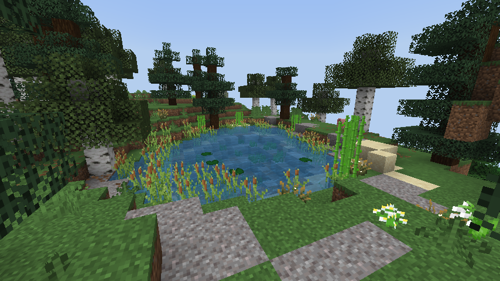
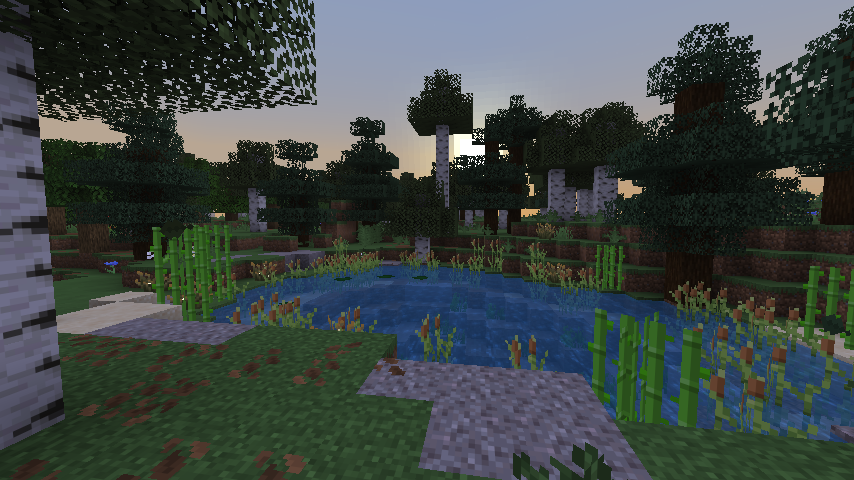
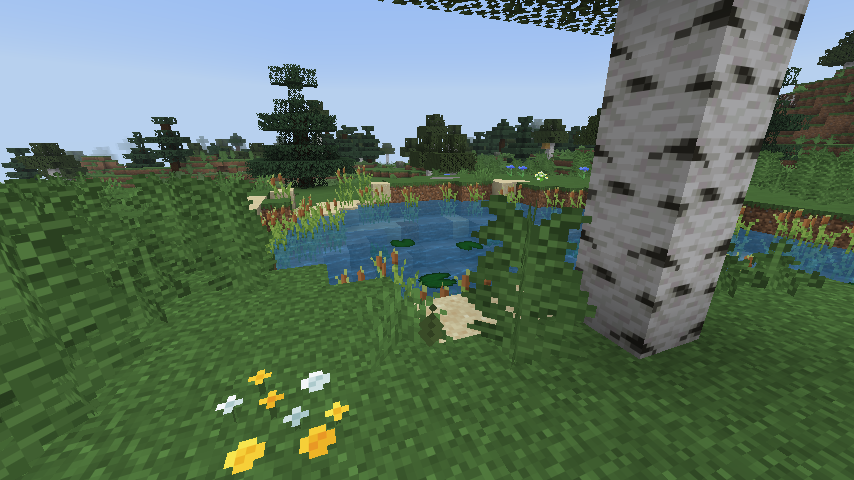
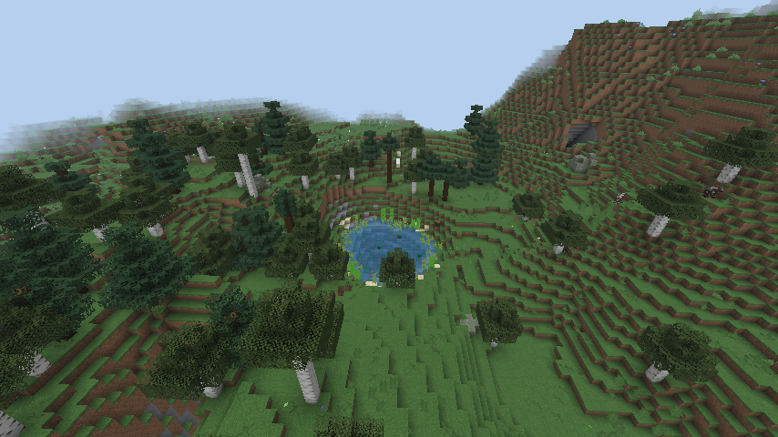

# Простор

Fabric-мод для **Minecraft 1.21.11**: новая природа верхнего мира. Биомы вписаны в ванильную раскладку
климата: каждый появляется только там, где ему место по температуре, влажности и рельефу, и никогда
в океане, во льдах или в пустыне.

| | |
|---|---|
|  |  |
| Озеро в Озёрном крае: камыш, кувшинки, берёзы | Закат над озером |
|  |  |
| Вид с воды: заросли камыша, песчаная отмель, тростник | Озёра между холмами сверху |

*Скриншоты сняты автоматически в настоящем игровом клиенте (см. «Сборка и проверка»).*

> Версия 0.1.0: первый биом, **Озёрный край**. Следующие по плану: широкие реки с поймами, речные каньоны,
> гигантские водопады, болотистые низины.

## Озёрный край

Прохладный холмистый край на стыке леса и тайги: россыпь небольших чистых озёр между холмами,
берёзовые и еловые рощи с полянами, замшелые валуны, папоротники и северные цветы.

- **Озёра** размером от 6 до 13 блоков в радиусе (до 35 блоков в длину), примерно одно на каждые
  70×70 блоков биома. Берега пологие: у воды земля вровень с водой, дальше мягкий подъём, который
  на расстоянии 10 блоков переходит в обычный рельеф. Если склон слишком крутой, вместо большого озера
  получается маленькое или не получается никакого (ямы со стеной с одной стороны не бывает). Дно песчаное и галечное
  у кромки, на глубине глинистое. Глубина до 6 блоков, вдоль берега мелководье глубиной в один блок.
  Примерно у трети больших озёр есть островок.
- **Вода не утекает и не висит.** Уровень воды в каждом озере один. Пещеры под дном и в берегах
  заделаны землёй, а в ложбинках у кромки насыпан вал.
- **Камыш (рогоз)** — новый блок высотой в два блока. Заросли стоят на мелководье и вдоль берега.
  Растёт на земле, песке, глине и гравии, если рядом есть вода; в компостере даёт 50%.
- У воды растут кувшинки, водоросли, сахарный тростник и светлячковые кусты (ночью они светятся).
- **Атмосфера и цвет:** свежая прохладная зелень травы и листвы, прозрачная голубая вода, мягкий
  светлый туман у горизонта, лесная музыка. В озёрах водится лосось, на берегах лисы, кролики и волки.
- Под землёй всё как обычно: шахты, руины троп, испытательные камеры, крепости.

### Где встречается и как часто

| Настройка | Доля суши | Примерно как |
|---|---|---|
| `rare` | ≈ 1% | редкий, как старый сосновый лес |
| `normal` | ≈ 1,7% (замерено на сиде `prostor`) | как берёзовая роща (2,3%) |
| `common` | ≈ 2,5% | как тёмный лес |

Значения `rare` и `common` рассчитаны по ширине климатической полосы; замерено только `normal`.


Только на суше вглубь от берега, в прохладном поясе (там, где ванильные лес и тайга) и на холмистом
рельефе. Озёрный край забирает у леса и тайги полосу влажности на их стыке, поэтому он окружён лесами
и тайгой. В снегах, пустынях, джунглях, горах и океанах его нет.

## Команды (для операторов)

| Команда | Что делает |
|---|---|
| `/prostor tp lake_district` | переносит в ближайший Озёрный край на берег озера, лицом к воде |
| `/prostor locate lake_district` | показывает координаты и расстояние |
| `/prostor locate_all` | ищет все биомы мода |

Ванильная команда тоже работает: `/locate biome prostor:lake_district`.

## Настройки: `config/prostor.json`

```json
{ "lake_district": "normal" }
```

`off`, `rare`, `normal` (по умолчанию) или `common`. Частота влияет на новые чанки, поэтому менять её
лучше до создания мира.

## Установка

Нужны Fabric Loader 0.19.5+ и Fabric API для 1.21.11. Готовый файл: [`dist/prostor-mod.jar`](dist/prostor-mod.jar).

## Сборка и проверка

Всё собирается и проверяется в GitHub Actions:

- **Build Prostor Mod** — `./gradlew build`, jar кладётся в `dist/`;
- **Verify Prostor Runtime** — настоящий Fabric-сервер на 120 секунд и `/prostor locate_all`;
- **Prostor Client Screenshots** — настоящий клиент под xvfb (Fabric Client GameTest): обычный мир
  с сидом `prostor`, телепорт к озеру, скриншоты в `docs/screenshots` и замеры `STATS|`
  (доля биома, висящая и вытекающая вода, число растений);
- **Probe Prostor APIs** — справка по декомпилированным исходникам Майнкрафта и ванильным данным.

Текстуры рисуются скриптом `tools/textures.py` (Pillow).
